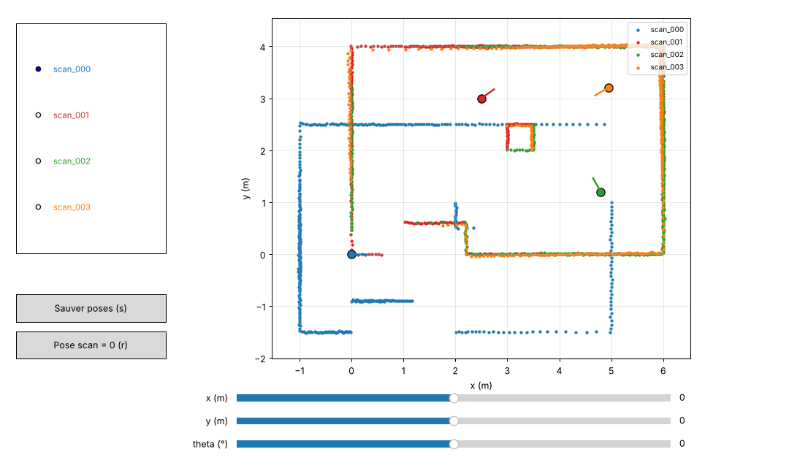
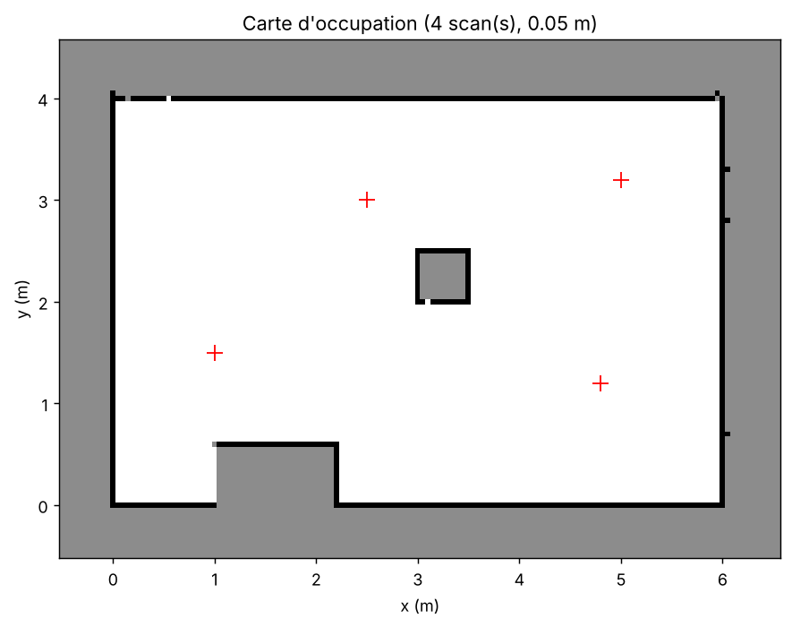
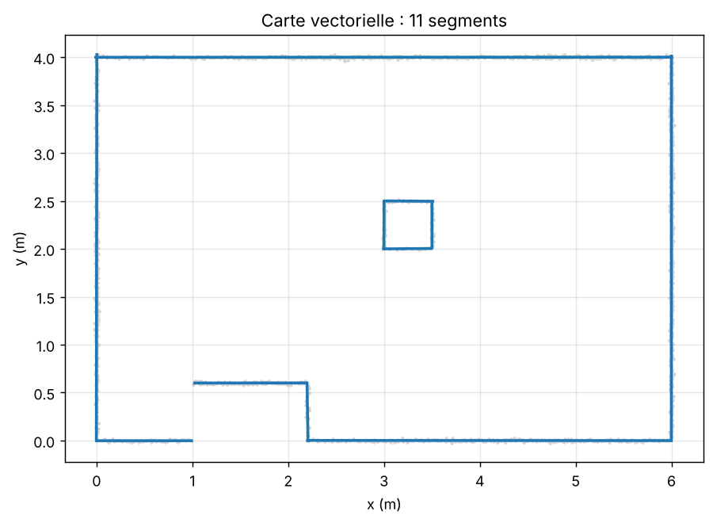

# Compte rendu – TP Jour 1 : extraction, visualisation et cartographie

> **État de ce document.** La démarche, les choix techniques et les tests sont décrits d'après le
> code fourni. Les images de `exemples_synthetiques/` viennent d'un lidar **simulé** (salle de 6 × 4 m,
> bruit de 1 cm) : elles prouvent que les algorithmes fonctionnent, pas que ta salle de classe est
> bien cartographiée. Les passages marqués **[À COMPLÉTER]** attendent tes mesures réelles.
> Les documents « Construction d'une grid map 2D… » et « Construction d'une carte vectorielle 2D… »
> cités par le sujet n'étaient pas dans le dossier de ressources : j'ai appliqué les méthodes
> classiques (log-odds + tracé de rayons ; split-and-merge). **Compare avec ces documents** et
> adapte les paramètres ou les étapes si ton cours impose autre chose.

## 1. Extraction des données lidar

**Démarche.** Le LD06 envoie en continu des trames de 47 octets (en-tête `0x54 0x2C`, 12 mesures
distance/intensité, angles de début et de fin en centièmes de degré, CRC8). La librairie fournie
(`ld06.cpp`) les décode et reconstruit les 12 angles intermédiaires par
`θn = début + (n + 0,5)·Δθ`, puis convertit le sens horaire du capteur en sens trigonométrique
(`θ = 360° − θLD06`). Un nouveau scan est détecté quand l'angle repasse de 360° à 0°.

**Ce que j'ai fait.** Sketch `ESP32_LD06_Test.ino` modifié pour appeler `printScanCSV` (au lieu de
`printScanTeleplot`) ; `capture_serial.py` lit le port série (115200 bauds), découpe les scans
(ligne vide = fin de scan), ignore les tours incomplets (< 100 points) et enregistre un fichier par scan
`angle_deg,distance_mm,intensity`. La même acquisition est aussi possible sans Python avec `lidar_web.html` (API Web Serial de Chrome/Edge) : la page décode le même flux, affiche le nuage en direct, enregistre les scans avec leur pose et exporte un .zip lisible par les outils Python. Son noyau de calcul est un portage du code Python ; sur les mêmes scans simulés il donne les mêmes résultats (11 segments, mêmes cellules occupées et libres). Elle n'a été testée qu'avec un port série simulé, pas encore avec le lidar réel.

On garde les coordonnées **polaires** : elles sont réutilisées pour
tous les traitements suivants.

**Point d'attention.** La librairie calcule aussi `x` et `y`, mais avec
`y = … − distance·sin(angle)` : sur le code fourni, cela donne une image en miroir par rapport à la
convention du module (angle anti-horaire, Y vers le haut). Je n'utilise donc **jamais** ces colonnes :
`lidar_io.py` recalcule `x = r·cos θ`, `y = r·sin θ`. À valider sur le robot avec un obstacle de position
connue (par ex. un carton à gauche du robot doit apparaître avec y > 0).

**[À COMPLÉTER]** nombre de scans par position, positions utilisées, plan sommaire de la salle avec
les poses mesurées, fréquence de rotation observée, points aberrants rencontrés.

## 2. Visualisation des nuages de points

`viewer.py` : chaque scan est converti en cartésien puis placé dans le monde par sa pose
`(x, y, θ)` : `p_monde = R(θ)·p_lidar + (x, y)`. Une couleur par scan, un disque + un trait pour
l'origine et l'orientation. Pose modifiable indépendamment par curseurs ou au clavier, sauvegardée en JSON.
Les points invalides (distance 0 ou > 12 m) sont retirés à la lecture.

*Capture sur données simulées : `scan_000` volontairement laissé à (0, 0, 0°), les trois autres sont
alignés.* **[À COMPLÉTER]** capture avec tes vrais scans et la méthode d'alignement employée.

## 3. Grille d'occupation 2D

**Principe.** Chaque cellule stocke un log-odds `l = ln(p/(1−p))` (0 = inconnu). Pour chaque
point du scan, on trace un rayon de la cellule du lidar jusqu'à la cellule d'impact :

- cellules **traversées** : `l += −0,4` (probablement libres) ;
- cellule d'**impact** : `l += +0,85` (probablement occupée) ;
- `l` borné dans [−4 ; +4] pour que la carte puisse changer d'avis.

Classification : occupée si `p ≥ 0,60`, libre si `p ≤ 0,45` et déjà observée, sinon inconnue.

**Outils.** `scan2grid` crée une carte qui contient exactement un scan placé à sa pose ;
`update` prend une carte existante (`.npz`), un scan et sa pose, et la met à jour ; `build` intègre
tous les scans d'un dossier (option `--steps` pour une image par étape).

**Choix techniques.**
- Tracé de rayon de type DDA/Bresenham vectorisé (`n = max(|Δi|,|Δj|)` échantillons arrondis).
- Chaque cellule n'est mise à jour **une seule fois par scan** : sinon les cellules proches du
  capteur, traversées par des dizaines de rayons, deviendraient certaines en un seul scan.
- Une cellule à la fois touchée et traversée dans le même scan reste **occupée** (l'impact l'emporte) :
  sans cela, les rayons rasants effacent les murs.
- Mesure à 0 (pas d'écho) : ignorée, car on ne sait pas si l'espace est libre.
- Option « durée de vie » : `--forget 0,98` multiplie les log-odds par 0,98 à chaque scan.

**Hypothèses.** Pose du lidar connue pour chaque scan ; environnement statique pendant l'acquisition ;
repère lidar = repère robot.

**Limites et difficultés rencontrées.**
- Sur l'image simulée, quelques cellules de mur restent « libres » : une cellule touchée dans un scan
  et traversée dans plusieurs autres (bruit de 1 cm sur des cellules de 5 cm) perd ce duel. Réglable
  (`l_free`, résolution, seuils). J'ai d'abord mis `l_free = −0,7` : les trous étaient plus nombreux, d'où `−0,4`.
- Avec des poses estimées à la main (erreur de plusieurs cm / degrés), les murs seront épais ou
  doublés : il n'y a pas de recalage de scan à ce stade (c'est l'objet de la suite du module).
- La taille de la carte est fixée à sa création ; les mesures hors carte sont ignorées.

*Données simulées, 4 scans, cellules de 5 cm : gris = inconnu, blanc = libre, noir = occupé. L'intérieur
du pilier et du meuble reste gris : il n'est jamais vu.* **[À COMPLÉTER]** grille de ta salle,
résolution retenue et justification.

## 4. Segments

Toutes les fonctions sont dans `segments.py`, testées dans `tests/test_segments.py` (33 tests).

**Tolérances numériques.** `EPS_LEN = 1e-9 m` (égalité de longueurs, « à l'extrémité ») et
`EPS_SIN = 1e-9` (parallélisme : |sin de l'angle| ≤ EPS_SIN). Ce sont des valeurs par défaut,
modifiables en argument. Elles sont volontairement minuscules : le test porte sur la géométrie exacte,
pas sur le bruit du capteur (qui est géré par les tolérances de `are_close`).

**Points → segments** (`extract_segments`, split-and-merge) :
1. points triés par angle ;
2. coupure des groupes aux grands sauts entre voisins (`max(0,15 m ; 4·r·Δθ)`) ;
3. découpe récursive de type Douglas-Peucker : on coupe au point le plus éloigné de la corde si
   l'écart dépasse 3 cm ;
4. ajustement par moindres carrés totaux, rejet si erreur RMS > 4 cm, moins de 5 points ou longueur < 15 cm ;
5. extrémités = projections du premier et du dernier point sur la droite ajustée.

**Opérations.**

| Fonction | Définition |
| --- | --- |
| `angle_between(a, b, oriented)` | `atan2(|a×b|, a·b)`. `oriented=True` : [0, π] ; sinon angle entre droites dans [0, π/2] |
| `are_close(a, b)` | angle entre droites ≤ `ang_tol` **et** écart latéral du plus court à la droite du plus long ≤ `dist_tol` **et** trou entre segments ≤ `gap_tol` (symétrique) |
| `merge(a, b)` | droite des moindres carrés totaux sur les 4 extrémités pondérées par la longueur, puis projection ; segment de la plus petite à la plus grande projection, sens de `a` |
| `intersection(a, b)` | `(point, t, u)` ou `None` si parallèles/colinéaires ou hors d'un des segments (marge `tol`) |
| `cut_by(seg, cutter)` | voir ci-dessous |

**Règles de `cut_by` (exigées par le sujet) et cas limites testés :**

| Cas | Résultat | Test |
| --- | --- | --- |
| intersection strictement à l'intérieur, côtés inégaux | on garde le plus long côté | `test_cut_keeps_longer_side_first/second` |
| intersection exactement à une extrémité de `seg` | `seg` inchangé | `test_cut_endpoint_of_seg_unchanged` |
| intersection à moins de `tol` d'une extrémité / à plus de `tol` | inchangé / découpé | `test_cut_within_tol_of_endpoint_unchanged` |
| segments colinéaires (recouvrement ou non) | jamais découpés | `test_cut_collinear_not_cut` |
| segments parallèles | inchangé | `test_cut_parallel_not_cut` |
| `cutter` ne touche pas `seg` | inchangé | `test_cut_no_intersection_unchanged` |
| `cutter` qui s'arrête sur `seg` (jonction en T) | découpé (intersection sur les deux segments) | `test_cut_cutter_ends_on_seg_counts` |
| `cutter` qui s'arrête à moins de `tol` de `seg` / à plus de `tol` | découpé / inchangé | `test_cut_cutter_just_misses_within_tol_still_counts` |
| deux côtés égaux | on garde le côté de `seg.p1` | `test_cut_equal_halves_*` (y compris segment inversé) |
| côtés égaux à `tol` près / juste au-delà de `tol` | côté de `p1` / plus long côté | `test_cut_tie_within_tol`, `test_cut_just_above_tie_tolerance_keeps_longer` |
| segment de longueur nulle | inchangé | `test_cut_degenerate_segment_unchanged` |

La tolérance sur la position de l'intersection est convertie en paramètre : `tol / longueur`.

## 5. Carte vectorielle

**Pipeline** (`vectormap.py`, `VectorMap.update`) pour chaque scan et sa pose :
1. extraction des segments dans le repère du lidar ;
2. passage dans le repère monde (pose appliquée aux deux extrémités) ;
3. pour chaque nouveau segment : si un segment de la carte lui est « proche » → `merge`, sinon ajout ;
4. consolidation : fusion répétée des segments de la carte devenus proches entre eux ;
5. résolution des croisements : un nouveau segment qui **croise franchement** un ancien (intersection à
   plus de 5 cm des deux extrémités, angle ≥ 30°) découpe l'ancien avec `cut_by` (plus long côté gardé) ;
6. filtrage optionnel (`prune`) : poids (nombre d'observations fusionnées) et longueur minimaux.

**Deux problèmes rencontrés et corrigés pendant les tests sur données simulées :**
- Un petit tronçon bruité de 28 cm près d'un coin croisait le grand mur à ~11° : il était pris pour
  un croisement et **coupait 23 cm du mur**. Correction : angle minimal de 30° pour qu'un croisement
  compte. Les croisements « en X » à angle franc restent traités.
- Ce même tronçon n'était pas fusionné avec le mur (11° > 10°) alors qu'il en était à moins de 6 cm.
  Sur un segment court, un bruit de quelques cm fait tourner la droite ajustée de plusieurs degrés :
  le seuil angulaire est élargi de `atan(dist_tol / longueur_du_plus_court)`, l'écart latéral
  continuant à garantir la cohérence géométrique. `are_close` reste, lui, strictement conforme au sujet.

**Résultat simulé :** 11 segments pour une salle contenant 4 murs, un pilier et un meuble
(le côté du meuble aligné avec le point de vue n'est vu que de façon rasante).

**Limites.** Pas de recalage : la qualité dépend directement de la précision des poses.
Un segment vu une seule fois a un poids de 1 (utiliser `--min-weight 2` pour filtrer avec plusieurs scans).
Les croisements fusionnés à tort avec un objet mobile ne sont pas gérés (pas de durée de vie des segments).
**[À COMPLÉTER]** carte vectorielle de ta salle, paramètres retenus, comparaison avec la grille.

## 6. Filtre des points isolés

Les relevés réels contiennent des points parasites (reflets, poussière, corps du robot, personnes qui passent).
Sur la carte ils dessinent des « rayons » de points isolés autour des positions du robot. Le filtre
(`scanfilter.py`, repris à l'identique dans `lidar_web.html`) travaille sur chaque scan avant la grille et les segments :

1. les points plus proches que 0,20 m du capteur sont retirés ;
2. chaque point (balayage trié par angle, circulaire) est relié à ses 2 voisins suivants si l'écart ne dépasse pas
   `max(0,10 m ; 4 × r_min × k × Δθ)` (r_min : la plus petite des deux distances, k : nombre de pas, Δθ : pas angulaire médian) ;
3. un groupe de moins de 8 points est supprimé ;
4. (option) confirmation : un point n'est gardé que si un autre scan voit un point à moins de 0,10 m, dans le repère de la carte.
   Cela retire aussi ce qui n'est vu qu'une fois (personne qui passe), mais demande des poses justes et efface les zones
   vues par un seul scan.

Relier à 2 voisins (et non 1) évite qu'un parasite glissé au milieu d'un mur le coupe en deux.
Les scans bruts restent en mémoire (`projet.json` est brut) ; les `scans/*.csv` exportés sont filtrés.

Essai sur la salle simulée avec bruit ajouté (30 scans, parasites isolés et collés au capteur) : environ 90 % des
parasites isolés et 100 % des points collés ou en petit groupe sont retirés, pour 0,7 % de vrais points perdus
(petits obstacles de moins de 8 points : environ 1,8 % avec les valeurs par défaut actuelles). **[À COMPLÉTER]** effet sur tes 11 scans : nombre de points ignorés
(affiché dans l'étape 4), segments avant/après.
Limite : une personne qui bouge près du robot forme un vrai groupe de points et n'est pas retirée par le filtre seul
(seule la confirmation par un 2e scan la retire).

### Grille d'occupation 2D sans / avec filtre

Pour juger le filtre, deux grilles sont construites sur la même étendue (`grid2d.py`, `grid2d_tool.py`, onglet « Grille 2D »
de l'application et de la page web) : l'une avec tous les points mesurés, l'autre avec les points gardés. Une cellule est
*isolée* si aucune de ses 8 voisines n'est occupée. Un bon filtre fait tomber les cellules isolées sans réduire beaucoup les
cellules occupées (les murs). Les carreaux se règlent en millimètres (entier, 10 à 500).

Exemple sur la salle simulée avec bruit ajouté (4 scans, carreaux de 50 mm, valeurs par défaut du filtre) :

| | Sans filtre | Avec filtre |
| --- | --- | --- |
| Cellules occupées | 742 | 582 |
| dont isolées | 155 | 9 |
| Points ignorés | 0 | 376 (21 %) |

Effet de « points min. » sur le même relevé :

| Points min. | Occupées | Isolées | Points ignorés |
| --- | --- | --- | --- |
| 1 | 740 | 153 | 7 |
| 4 | 583 | 8 | 340 |
| 8 | 582 | 9 | 376 |
| 12 | 561 | 10 | 465 |
| (sans filtre) | 742 | 155 | 0 |

Au-delà de 8, on perd des cellules de murs sans retirer plus de cellules isolées : 8 est un bon compromis ici.
Image : `exemples_synthetiques/grille2d_comparaison.png`. Limite : si les carreaux sont plus petits que l'espacement des
points (2 à 4 cm à 3 m), les murs deviennent pointillés et les cellules « isolées » augmentent (sur le relevé simulé : 68 à 20 mm,
502 à 10 mm), ce qui n'est plus un défaut du filtre. **[À COMPLÉTER]** mêmes tableaux sur tes scans réels
(`python grid2d_tool.py scans --poses poses.json --sweep-points 1,4,8,12`) et ta conclusion.

## Paramètres à régler sur ta salle

| Paramètre | Où | Défaut | Si ça ne marche pas |
| --- | --- | --- | --- |
| `--res` | `gridmap_tool` | 0,05 m | murs troués → 0,10 m ; trop grossier → 0,03 m |
| `l_free`, `l_occ` | `OccupancyGrid` | −0,4 / +0,85 | murs qui disparaissent → |l_free| plus petit |
| `--forget` | `gridmap_tool` | 1,0 (désactivé) | objets mobiles → 0,95 à 0,99 |
| `split_dist` | `extract_segments` | 0,03 m | trop de petits segments → 0,05 m |
| `ang_tol`, `dist_tol`, `gap_tol` | `VectorMap` | 10° / 6 cm / 15 cm | murs dédoublés → augmenter `dist_tol` |
| `--min-weight` | `vectormap_tool` | 1 | segments parasites → 2 |
| `min_points` | filtre des points isolés | 8 | parasites restants → 10 à 12 ; petits objets effacés → 4 à 5 |
| `min_range` | filtre des points isolés | 0,20 m | points collés au robot → 0,30 m ; obstacle proche effacé → 0,10 m |
| `break_min` | filtre des points isolés | 0,10 m | murs coupés en morceaux → 0,15 m |
| `--cell-mm` | `grid2d_tool`, onglet Grille 2D | 50 mm | murs pointillés → 80 à 100 mm ; trop grossier → 25 à 30 mm |

